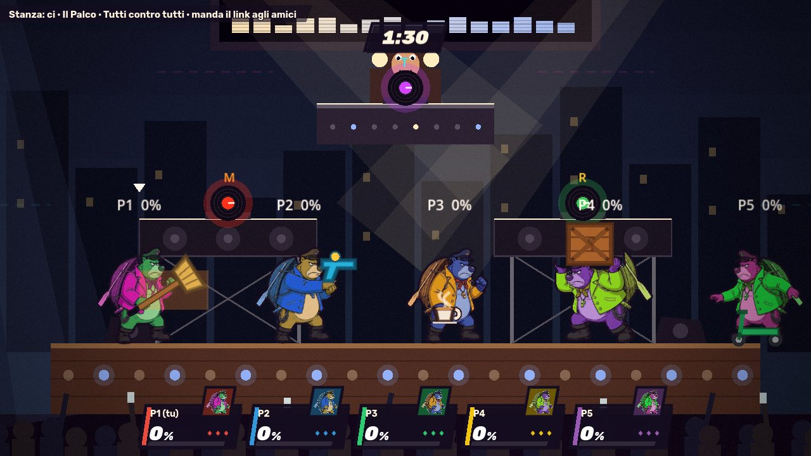

# Pose con gli oggetti: lo standard

Come si generano su Flow le animazioni di un personaggio che usa gli oggetti, in modo che **una clip valga per tutti
gli oggetti della stessa categoria** (Nicola, 5/11/2026). Primo personaggio: Capt. OrsoBlu. I prompt pronti sono in
[`pose-oggetti-prompt.md`](pose-oggetti-prompt.md), generati da `tools/flow/prompt_flow.py` (`PRESE`, `CLIP_OGGETTI`).

## L'idea: si anima la presa, non l'oggetto

Gli oggetti del gioco hanno sei categorie (`category` in `src/shared/items.ts`, vedi [docs/oggetti.md](../oggetti.md)).
Dentro una categoria cambia l'aspetto (scopa o pesce, pistola o sparabolle) ma non il modo in cui il corpo lo tiene. Quindi:

1. nella clip il personaggio tiene un **segnaposto magenta pieno** (`#FF00FF`), sempre uguale: bastone, blocco, palla, cubo o tavola;
2. lo script di taglio **trova il magenta** in ogni fotogramma, ne scrive punto e angolo in `mani.json` e lo **cancella** dal disegno;
3. il gioco disegna l'oggetto vero in quel punto, con quell'angolo. Un oggetto nuovo sceglie la categoria e non costa clip.

Il magenta perché è il colore più lontano dal verde dello sfondo e da quelli dei personaggi: non si confonde con lo scontorno.



**Stato (7/11/2026):** OrsoBlu ha le cinque prese: `gripIdle`, `gripWalk`, `gripLight`, `gripHeavy` (OB-O1),
`aimIdle`, `aimShoot`, `aimCharge` (OB-O2; nella clip non cammina, quindi niente `aimWalk`), `itemHold`, `itemThrow`,
`itemEat` (OB-O3; il lancio è venuto solo dall'alto, così `itemThrowUp` usa gli stessi fotogrammi), `carryIdle`,
`carryWalk`, `carryToss` (OB-O4) e `rideIdle`, `rideDash`, `rideHop` (OB-O5; dove la tavola sparisce nel salto la
presa resta sotto gli stivali). I tagli a mano sono in `tools/sprite/flow_tagli.json`; le strisce oltre 8192 px si
diradano con `tools/sprite/dirada_strisce.py`, che dirada anche `mani.json`.
Le clip di Flow hanno un bordo nero di 8 pixel per lato: si toglie prima del taglio (`ffmpeg -vf crop=iw-16:ih-16:8:8`).

## Le cinque prese

Sei categorie, cinque prese: lancio e consumo usano la stessa palla in mano.

| Presa | Segnaposto | Categorie | Posa ferma (prima e ultima immagine) | Clip | Stati |
|---|---|---|---|---|---|
| **Bastone** | bastone lungo un braccio, spesso come un manico di scopa | impugnatura | tenuto per il fondo con la mano verso chi guarda, pugno al fianco, punta in avanti e in alto a 45° | O1 | `gripIdle`, `gripWalk`, `gripLight`, `gripHeavy` |
| **Mira** | blocchetto grande come un mattone | sparo | in mano all'altezza del petto, gomito piegato, puntato in avanti come una pistola | O2 | `aimIdle`, `aimWalk`, `aimShoot`, `aimCharge` |
| **Palla** | palla grande come un'arancia | lancio, consumo | in mano all'altezza del fianco, braccio rilassato | O3 | `itemHold`, `itemThrow`, `itemThrowUp`, `itemEat` |
| **Peso** | cubo largo come le spalle | peso | sopra la testa a due mani, ginocchia piegate | O4 | `carryIdle`, `carryWalk`, `carryToss` |
| **Sella** | tavola piatta lunga quanto lui, senza ruote | cavalcatura | in piedi sopra, ginocchia piegate, braccia larghe come un surfista | O5 | `rideIdle`, `rideDash`, `rideHop` |

Il segnaposto **non lascia mai la mano**, nemmeno nei lanci: il gioco smette di disegnarlo nel fotogramma in cui
l'oggetto parte (`hitFrame`). Così prima e ultima immagine sono uguali e la clip si chiude come le altre.

Lo stato fermo (`gripIdle`...) è il primo mezzo secondo della clip: lo script lo taglia dai secondi, senza cercarlo fra le mosse.

## Quando il gioco usa ogni stato

Gli stati sono facoltativi (`OPTIONAL_ANIMATION_NAMES`): **si usano solo se il personaggio li ha disegnati**, altrimenti
il gioco fa come prima (le pose normali e l'oggetto davanti alla mano). Scelta in `godot/scripts/item_pose.gd`.

| Stato | Quando |
|---|---|
| `gripIdle`, `gripWalk` | fermo o mentre cammina con un oggetto da impugnatura |
| `gripLight`, `gripHeavy` | colpo leggero o forte (anche su, giù, in aria) con l'oggetto in mano |
| `aimIdle`, `aimWalk` | fermo o mentre cammina con un oggetto da sparo |
| `aimShoot` | appena spara (evento `gear` `shot`) |
| `aimCharge` | il getto carico (evento `gear` `jet`) |
| `itemHold` | fermo con in mano un oggetto da lancio o da consumo |
| `itemThrow`, `itemThrowUp` | lancia un oggetto qualsiasi (evento `itemThrow`), in alto se l'oggetto sale più che avanzare |
| `itemEat` | consuma un oggetto (evento `powerUp`) |
| `carryIdle`, `carryWalk`, `carryToss` | porta un oggetto pesante, fermo o camminando; lo scaglia |
| `rideIdle`, `rideDash`, `rideHop` | su una cavalcatura: ferma, veloce, in aria |

## Il punto di presa: `mani.json`

Lo script di taglio scrive `public/assets/characters/<id>/mani.json`, per ogni stato e ogni fotogramma della striscia:

```json
{ "gripLight": [[x, y, gradi, lunghezza], ...], "rideDash": [...] }
```

- **x, y**: pixel del fotogramma, con l'origine **ai piedi** (`frameWidth / 2`, `footY`) e il personaggio rivolto a destra;
  y negativo = più su. Il gioco li moltiplica per `scale` e li specchia con `facing`, come il disegno.
- **gradi**: la direzione del segnaposto, 0 = verso destra, positivi in senso orario (y verso il basso, come Godot).
- **lunghezza**: quanto è lungo il segnaposto, in pixel del fotogramma.
- `null` in un fotogramma dove il magenta non si vede (coperto dal corpo): il gioco tiene quello di prima.

Che punto è, per presa:

| Presa | Punto | Angolo |
|---|---|---|
| bastone, mira | l'estremità tenuta in mano (quella più vicina al centro del corpo) | dalla mano verso la punta |
| palla, peso | il centro del segnaposto | 0 |
| sella | il centro della tavola | lungo la tavola |

## Le regole del prompt

Valgono le regole del [README](README.md#le-regole-dei-prompt-imparate-il-311), più queste:

1. **Blocco OBJECT** subito dopo CHARACTER (al posto di WEAPON), identico in tutte le clip della stessa presa:
   forma, misura, `solid flat magenta (#FF00FF)`, contorno nero sottile, niente dettagli né ombre.
2. **Nient'altro magenta o rosa** nell'immagine: si dice nell'AVOID. Un personaggio con un colore vicino al magenta
   (lilla, rosa acceso) va controllato sul foglio: se lo script lo prende per segnaposto, si cambia il colore del segnaposto solo per lui.
3. **Il segnaposto non cambia mai** forma, colore o misura, non si piega, non sparisce, non si sdoppia e non lascia la mano (o i piedi).
4. **Inquadratura:** il personaggio **e il segnaposto** restano dentro con un margine largo su ogni lato, anche a braccio
   alzato col bastone o col cubo sopra la testa. Un bastone tagliato dal bordo dà un punto sbagliato.
5. **Guardia con l'oggetto:** ogni mossa parte e finisce nella posa ferma con l'oggetto, come i colpi del pacchetto base.
6. **Mai più di 3 mosse e 2 attacchi** per clip, con le stesse finestre di secondi delle altre clip (`WINDOWS`).

## Le immagini di partenza

Una per presa, con Nano Banana (0 crediti), allegando il fermo del personaggio (`riferimenti/personaggi/<id>.png`):
stesso personaggio, stessa grandezza, piedi nello stesso punto, cambiano solo le braccia (e le gambe per peso e sella).
Vanno in `riferimenti/partenze/<id>_<presa>.png` e fanno da prima **e** ultima immagine della clip (Frames to video).

**Scartala se:** il personaggio cambia, i piedi si spostano, il segnaposto non è magenta pieno o ha dettagli, c'è altro
magenta o rosa, qualcosa tocca il bordo.

## Tagliare

```bash
python3 tools/sprite/dal_video.py OB-O1 OB-O1_impugnatura.mp4 /tmp/ob-o1 --scrivi
```

Per le clip `-O` lo script trova il magenta, scrive i punti in `mani.json` (un blocco per stato, unito a quelli che
ci sono già) e lo toglie dalle strisce. Nel foglio di controllo il punto è un pallino giallo con una linea verso la punta:
**controllalo sempre**. Avvisi nel resoconto:

- `magenta non trovato in N fotogrammi`: coperto dal corpo o sparito. Se succede in più di metà di uno stato, rigenera;
- `magenta troppo grande`: Flow ha colorato di magenta qualcos'altro; guarda il foglio.

## Un personaggio nuovo, un oggetto nuovo

- **Personaggio:** aggiungi il suo id a `OGGETTI_PER` in `prompt_flow.py` e rigenera: escono 5 immagini e 5 clip
  (50 crediti con Veo Lite). Se tiene già qualcosa in mano (il mattarello di Nonna Gina), scrivi nella posa con che mano tiene il segnaposto.
- **Oggetto:** sceglie la categoria in `items.ts` e si disegna in `godot/scripts/` con il manico (o il centro) nell'origine
  e la punta verso destra (+x): il gioco lo ruota sull'angolo della presa. Niente clip nuove.
